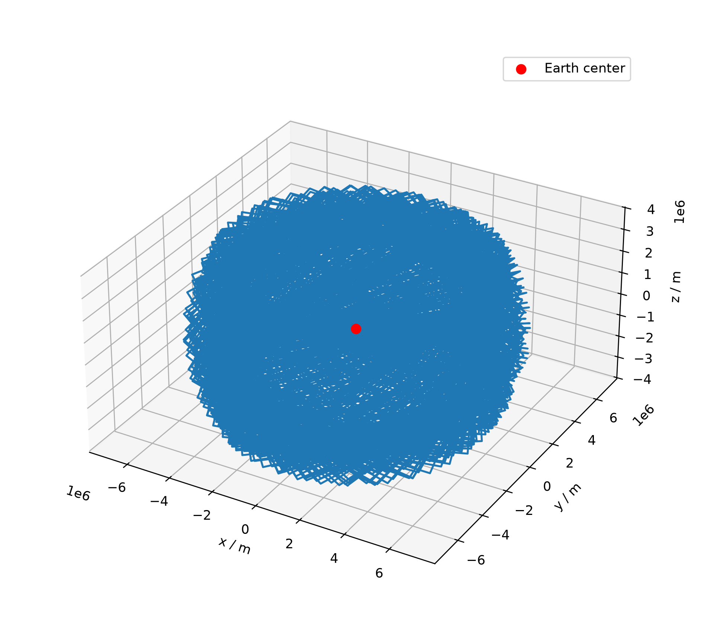
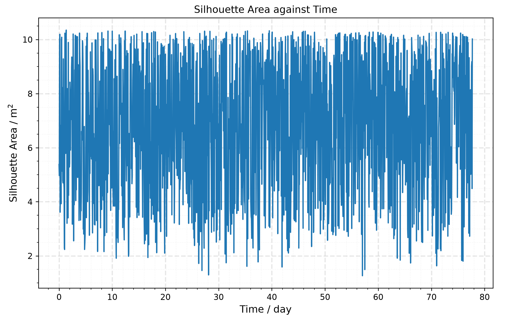
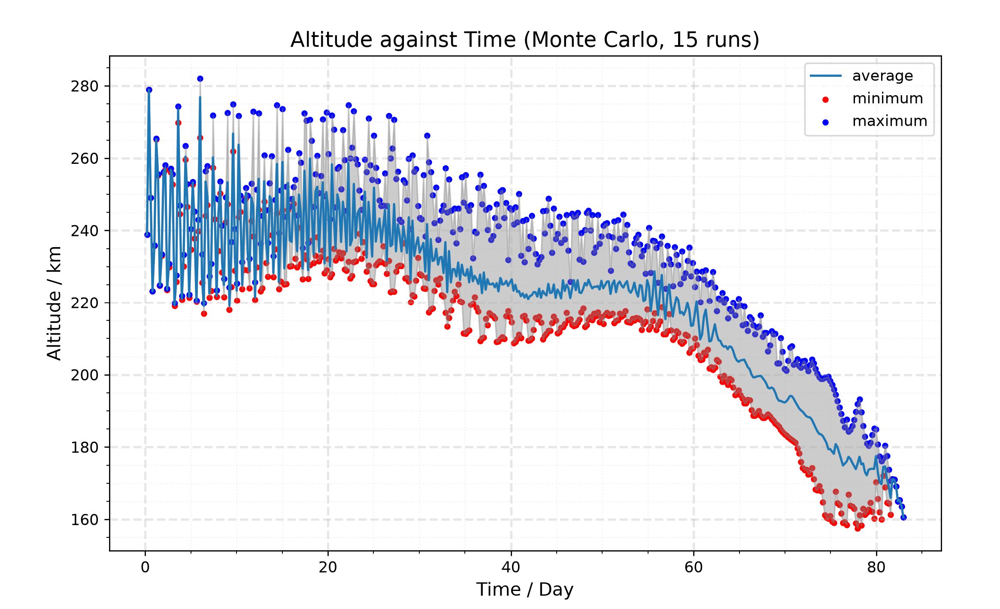
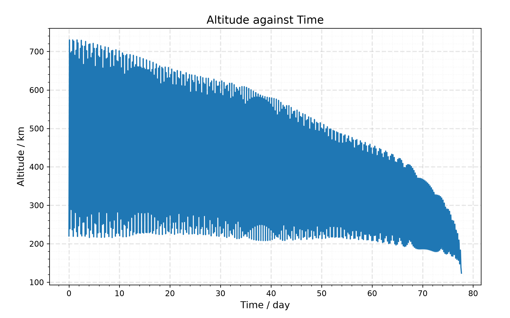
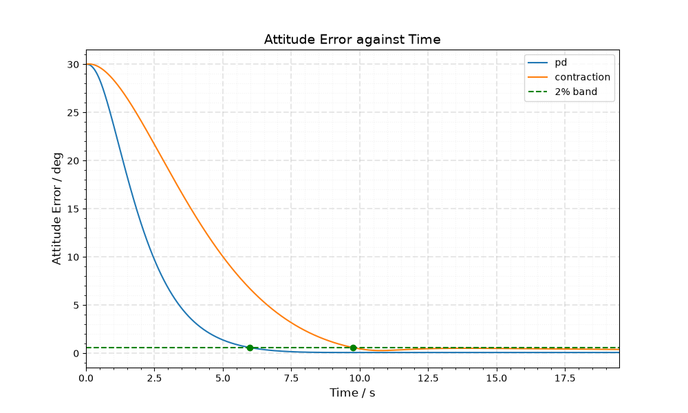
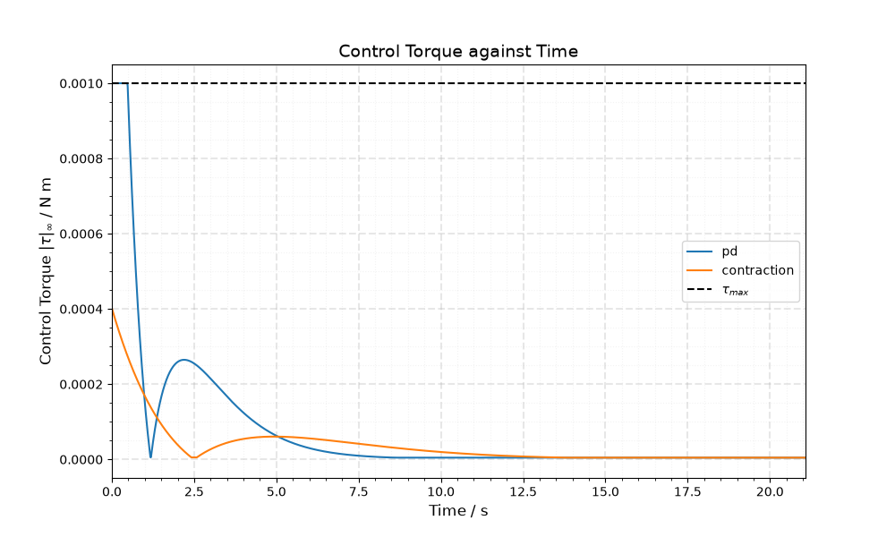
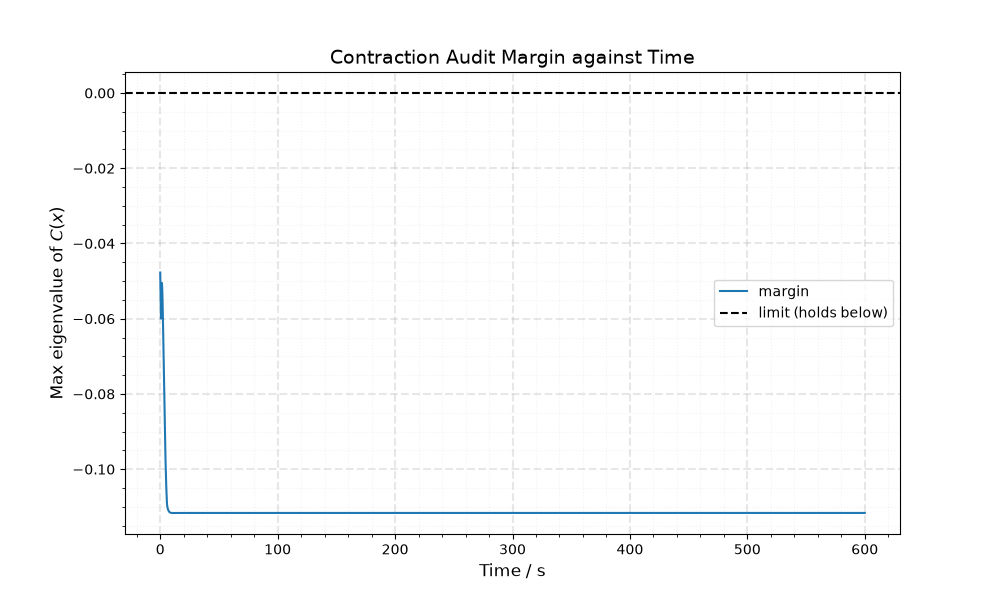
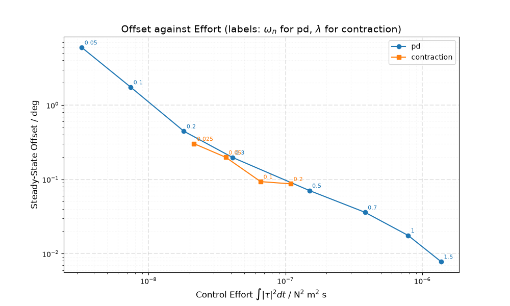

# Orbital Propagator

A full technical writeup, covering the state vector, integration method, perturbation and drag models, attitude dynamics derivations, and control theory comparisons is available ([here](https://drive.google.com/file/d/1eVhonOmglabFQFT5dziGbBMAgRy_dJVF/view?usp=sharing)).

A 6 degree-of-freedom orbital decay simulator, coupling orbital and attitude dynamics for a tumbling satellite under atmospheric drag, J2/J3/J4 gravitational perturbations, and stochastic solar flux (F10.7) Monte-Carlo variation.

This project began as a rudimentary Excel spreadsheet model and has been extended into a coupled Python simulation. Since drag depends on the satellite's instantaneous cross-sectional area, and that area changes continuously as the satellite tumbles, orbital decay and attitude dynamics cannot be modeled independently.

## Features

- **13-element state vector**: position, velocity, quaternion orientation, and body-frame angular velocity, integrated together via adaptive RK45 (Dormand-Prince)
- **Coupled attitude-orbit dynamics**: tumble drives time-varying cross-sectional area, which drives drag, which drives orbital decay
- **Perturbations**: J2, J3, and J4 zonal harmonics (Earth oblateness and higher-order gravity effects)
- **Atmospheric model**: NRLMSISE-00 via [`pymsis`](https://github.com/SWxTREC/pymsis), including stochastic F10.7 solar flux variation via a Monte Carlo Ornstein-Uhlenbeck process
- **Attitude dynamics**: gravity-gradient and aerodynamic torques, quaternion kinematics (gimbal-lock free), Euler's rigid body equations
- **Attitude control**: a PD controller and a contraction-theory controller (gain from a linear matrix inequality, with a numerical audit of the certificate), compared on a small test body

## Repository Structure

| Folder | Contents |
|---|---|
| `z_main/` | Configuration, dynamics function, and integrator |
| `forces/` | Gravity, drag, and J2/J3/J4 perturbation forces |
| `torques/` | Gravity-gradient and aerodynamic torques |
| `tumble/` | Quaternion kinematics, angular acceleration, inertia, silhouette/cross-section area |
| `control/` | PD and contraction controllers, LMI synthesis, Jacobian, certificate audit, controller comparison and gain sweep |
| `plotting/` | Plots for single, Monte Carlo and control runs |
| `tests/` | Jacobian finite-difference check and certificate tests (`python tests/test_suite.py`) |
| `conversion/` | Orbital element ↔ Cartesian, inertial ↔ body frame conversions |
| `environment/` | Atmospheric density lookup, stochastic F10.7 model |
| `simulate.py` | Entry point, runs the simulation and generates plots |

## Getting Started

```bash
pip install numpy scipy matplotlib pymsis cvxpy
python simulate.py
```

`simulate.py` asks for a mode:

| Mode | What it runs |
|---|---|
| `single` | One uncontrolled propagation (orbit, altitude, silhouette area) |
| `stochastic` | Monte Carlo batch over random F10.7 trajectories |
| `control` | PD vs contraction controller from the same starting attitude, with a metrics table and certificate audit |

Run the tests with `python tests/test_suite.py`. It re-synthesises the contraction gain first without a fixed seed, so it overwrites `control/K.npy` and `control/M.npy` with a slightly different gain.

Model parameters (orbit, satellite geometry, integration settings) are set in `z_main/config.py`.

`single` and `control` plots are saved to `_docs/images/`, replacing any earlier copies, including the images shown below.

## Results

**Orbit around Earth (`single` mode):** the trajectory of the object as it orbits around the Earth.



**Silhouette area over time (`single` mode):** the projected cross-sectional area oscillates as the satellite tumbles, which drives the time-varying drag force.



**Monte Carlo altitude decay (15 runs) (`stochastic` mode):** decay uncertainty grows over time as stochastic F10.7 variation compounds across the propagation window.



**Single-run altitude decay (`single` mode):** periapsis and apoapsis oscillation shown as a filled band, with a sharp final descent as drag intensifies near reentry.



## Attitude Control

The control layer is tested on a small test body (about 0.0038 kg m² inertia, 1 mN m torque limit) starting 30° off target, rather than the full decay satellite.

- **PD**: `tau = -Kp q_e,vec - Kd w`, with gains set from a chosen natural frequency and damping ratio. Its steady-state offset is predicted as `2 |d| / Kp`, where `d` is the disturbance torque, and the simulated offset agrees to within about 2%.
- **Contraction**: a constant-metric controller found by solving a linear matrix inequality (`cvxpy`) over sampled error states, with the torque limit built in. A numerical audit then checks the contraction condition at every unclipped sample along the run.
- **Comparison**: both controllers see the same start, disturbance and torque limit, and are compared by settling time (to within 2% of the initial error), steady-state offset, peak torque and control effort (`control` mode). A gain sweep across both controllers exists in `control/sweep.py` as a working extension, not yet wired into `simulate.py`.

**Attitude error (`control` mode):** PD settles faster here, but it also uses more control effort and saturates the actuator during the first second, while the contraction gain stays inside the limit.



**Control torque (`control` mode):** the torque limit is built into the contraction synthesis, so its command stays below `tau_max`. Most of the effort for both controllers is spent during the initial slew.



**Contraction audit (`control` mode):** the largest eigenvalue of the contraction condition stays negative throughout the run, so the condition holds at every sample.



**Offset against effort (`control/sweep.py`):** across a range of gains, the two controllers lie close to one trade-off curve. Neither clearly wins at matched effort, so the main difference is the certificate that the contraction gain carries.



## Status & Next Steps

The propagator and the attitude control comparison (PD and contraction) are functionally complete. Possible extensions: integral action (PID), tracking a moving reference such as the velocity-pointing frame, and a state-dependent contraction metric.

## References

Key models and constants are drawn from Vallado (2013), Schaub and Junkins (2018), and Picone et al. (2002), and the contraction controller builds on Lohmiller and Slotine (1998). Please see the report for complete citations.